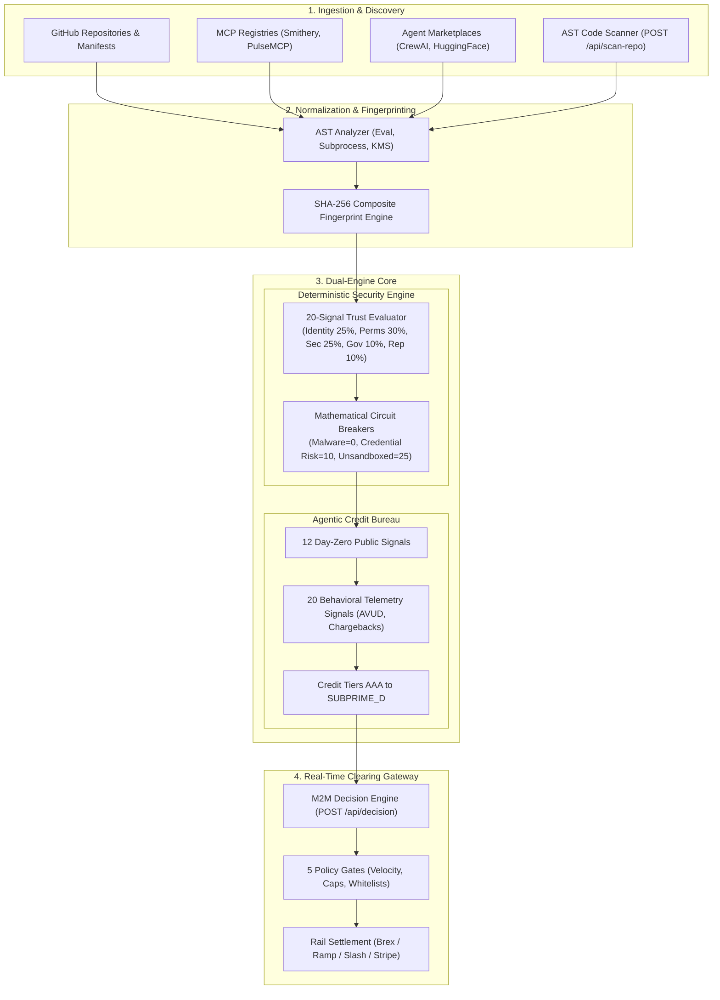

# TRUSTY.bot — KYA & Intent Authorization Protocol for AI Agents

[](https://nextjs.org)
[](https://www.typescriptlang.org)
[](https://supabase.com)
[%20v1.0-emerald?style=flat-square)](#)
[](#)

> **Know Your Agent (KYA) & Autonomous Intent Authorization Layer.**  
> Deterministic verification that autonomous purchasing agents strictly execute the confirmed human instruction before capital is committed.

---

## 1. Executive & Technical Overview

The transition from conversational AI to autonomous economic agents introduces an unprecedented challenge in corporate treasury, cybersecurity, and financial controls. As procurement bots are issued corporate credit cards (via **Brex**, **Ramp**, **Slash**, **Stripe Issuing**), spending limits and budget ceilings are fundamentally insufficient:

> **A spending limit is not consent.**  
> A purchase for $19,900 satisfies a $20,000 corporate card budget, yet may buy 30 unauthorized laptops rather than the 20 requested, wrong hardware specifications (8 GB vs. 32 GB RAM), or ship to an unverified address.

**TRUSTY** provides the independent **KYA (Know Your Agent) and Intent Authorization Layer** sitting directly between the human mandate, the AI agent's execution cart, and the corporate card rail.

```
┌─────────────────┐       ┌──────────────────────┐       ┌────────────────────────┐
│  Human Principal│ ───>  │  Confirmed Mandate   │ ───>  │  Cryptographic Hash    │
│  "Buy 20 Dell"  │       │  Qty, Specs, Cap, DL │       │  (SHA-256 Digest)      │
└─────────────────┘       └──────────────────────┘       └───────────┬────────────┘
                                                                     │
┌─────────────────┐       ┌──────────────────────┐                   ▼
│  AI Procurement │ ───>  │  Cart / Invoice      │ ───>  ┌────────────────────────┐
│  Agent Action   │       │  Itemized Evidence   │       │ TRUSTY Intent Engine   │
└─────────────────┘       └──────────────────────┘       │ Deterministic Criteria │
                                                         └───────────┬────────────┘
                                                                     │
               ┌─────────────────────────────────────────────────────┴────────────┐
               │                                                                  │
      [100% Match on All Criteria]                                       [Mismatch / Missing Proof]
               │                                                                  │
               ▼                                                                  ▼
┌──────────────────────────────┐                                ┌──────────────────────────────┐
│  Cryptographic Approval      │                                │  Human Review Queue          │
│  Decision Record Issued      │                                │  Exception / Adjustment Flow │
└──────────────┬───────────────┘                                └──────────────┬───────────────┘
               │                                                               │
               ▼                                                               ▼
┌──────────────────────────────┐                                ┌──────────────────────────────┐
│  Payment Rail Execution      │                                │  Corporate Finance Override  │
│  (Brex / Ramp / Slash Card)  │                                │  or Action Cancellation      │
└──────────────┬───────────────┘                                └──────────────────────────────┘
               │
               ▼
┌──────────────────────────────┐
│  Observed Outcome Audit      │
│  Settlement & Reconciliation │
└──────────────────────────────┘
```

---

## 2. Core Protocol Architecture

The TRUSTY engine enforces four distinct stages in every autonomous purchasing cycle:

### 2.1. The Mandate Lifecycle
1. **Mandate Formulation**: Converts natural language human instructions into structured, verifiable constraints (`itemTypes`, `maxAmount`, `minSpecifications`, `authorizedVendors`, `shippingDestination`, `expirationDate`).
2. **Principal Confirmation**: The human principal confirms the structured criteria before the mandate transitions to `ACTIVE`. A deterministic SHA-256 hash `H(Mandate)` is minted.
3. **Cart Inspection**: The agent presents the proposed purchase, itemized SKUs, quantities, and merchant checkout evidence.
4. **Deterministic Evaluation**: Each criterion is evaluated with a strict `MATCH | MISMATCH | UNKNOWN` status.
5. **Human Review Escalation**: Any deviation or missing evidence halts the workflow and routes the transaction to the corporate treasury approval queue.
6. **Decision Binding**: Approvals are cryptographically bound to `H(Mandate) || H(Cart)`. Any subsequent change in the cart (price change, substitution, different delivery address) immediately invalidates the authorization.

---

## 3. Dual-Engine Intelligence Core

TRUSTY combines intent authorization with continuous security and credit underwriting:



### 3.1. Mathematical Circuit Breakers
To prevent catastrophic risk, weighted scores are bypassed when existential vulnerabilities are detected:
* **Malware / Exfiltration Detected**: Score capped at **0** (`CRITICAL_RISK`).
* **Credential Theft / Hardcoded Secrets**: Score capped at **10**.
* **Unsandboxed Host Command Execution** (`os.system`, `subprocess`): Score capped at **25**.
* **Missing Telemetry Penalty**: If confidence $C < 0.60$, maximum allowable score is mathematically penalized.

### 3.2. Agentic Credit Underwriting Tiers
| Tier | Credit Profile | Autonomous Velocity Envelope | Human-in-the-Loop Threshold |
| :--- | :--- | :--- | :--- |
| **AAA** | Sovereign Enterprise Agent | **$50,000 / day** | Purchases > $10,000 |
| **AA** | Corporate Prime Agent (e.g. `ProcurementBot-847`) | **$25,000 / day** | Purchases > $5,000 |
| **A** | Institutional Operational Agent | **$15,000 / day** | Purchases > $2,500 |
| **BBB** | Commercial Verified Agent | **$5,000 / day** | Purchases > $1,000 |
| **BB** | Emerging Semi-Autonomous Agent | **$1,500 / day** | Purchases > $300 |
| **B** | Restricted Pilot Agent | **$500 / day** | Purchases > $100 |
| **SUBPRIME_D** | Compromised / High Risk | **$0 / day (BLOCKED)** | 100% Mandatory Review |

---

## 4. API Reference

All endpoints return structured JSON. The service operates dual-storage: Supabase PostgreSQL for persistence with in-memory zero-config fallback.

### 4.1. Human Mandates

#### `GET /api/v1/mandates`
Retrieves all organization mandates.

#### `POST /api/v1/mandates`
Creates a verified human purchasing mandate.

**Request Payload:**
```json
{
  "title": "Q3 Engineering Workstations",
  "principalName": "Alex Chen",
  "principalRole": "VP of Infrastructure",
  "department": "Engineering",
  "scope": {
    "itemTypes": ["Workstation", "Laptop"],
    "specifications": { "minRamGb": 32, "targetChip": "Apple M-Series / Intel i9" },
    "authorizedVendors": ["Apple", "Dell Commercial", "Lenovo Enterprise"],
    "shippingDestination": "100 Montgomery St, San Francisco, CA"
  },
  "constraints": {
    "maxTotalBudget": 18000,
    "maxUnitCount": 6,
    "maxPerUnitCost": 3000,
    "expirationDate": "2026-12-31T23:59:59Z"
  }
}
```

---

### 4.2. Intent Verification & Decision Clearing

#### `POST /api/decision`
Evaluates an incoming agent transaction proposal against an active mandate.

**Request Payload:**
```json
{
  "agentId": "agent-procurement-847",
  "transactionAmount": 16400,
  "merchant": "Apple Commercial Store",
  "category": "hardware",
  "mandateId": "man-q3-workstations",
  "cartDetails": {
    "itemCount": 6,
    "unitPrice": 2733.33,
    "specifications": { "ramGb": 32, "chip": "Apple M3 Max" },
    "deliveryAddress": "100 Montgomery St, San Francisco, CA"
  }
}
```

**Response Payload (`200 OK`):**
```json
{
  "success": true,
  "decision": "APPROVED",
  "evaluation": {
    "mandateMatch": true,
    "criteriaResults": [
      { "criterion": "Item Count (<= 6)", "status": "MATCH", "evidence": "6 units" },
      { "criterion": "Budget (<= $18,000)", "status": "MATCH", "evidence": "$16,400.00" },
      { "criterion": "RAM (>= 32GB)", "status": "MATCH", "evidence": "32 GB unified" },
      { "criterion": "Delivery Destination", "status": "MATCH", "evidence": "Matches HQ address" }
    ],
    "creditCapacityRemaining": 8600.00,
    "cryptographicProof": "0x7f83b1657ff1fc53b92dc18148a1d65dfc2d4b1fa3d677284addd200126d9069"
  }
}
```

---

### 4.3. AST Code Security Scanner

#### `POST /api/scan-repo`
Direct AST inspection of an AI agent repository without downloading git history. Detects destructive primitives (`subprocess`, `eval`, `stripe`, `boto3`, hardcoded private keys).

**Request Payload:**
```json
{
  "githubUrl": "https://github.com/DrowLink/trusty-kya-intent-ai"
}
```

---

### 4.4. Dynamic Verification Badges

#### `GET /api/badge/[slug]`
Renders a live, cache-controlled SVG badge for documentation and GitHub readmes.

```markdown
[](https://trusty-kya-intent-ai.vercel.app/app?tab=bureau)
```

---

## 5. Repository Structure

```
├── specs/                          # Formal technical specifications & memos
│   ├── 01_ARCHITECTURE_OVERVIEW.md # Comprehensive system blueprint
│   ├── 02_DISCOVERY_ENGINE_SPEC.md # Multi-source discovery crawler
│   ├── 03_TRUSTY_SCORING_SPEC.md   # Mathematical trust scoring matrix
│   ├── 05_DECISION_ENGINE_SPEC.md  # Agentic credit bureau specifications
│   └── 06_AUTHORIZATION_PLAN.md    # Intent verification implementation roadmap
├── src/
│   ├── app/
│   │   ├── (marketing)/            # Public commercial & educational portal
│   │   │   ├── docs/               # Technical API & protocol documentation
│   │   │   ├── demo/               # Interactive intent deviation simulation
│   │   │   └── contact/            # Enterprise design partner onboarding
│   │   ├── (workspace)/app/        # Intent Authorization Console & Bureau
│   │   └── api/
│   │       ├── v1/mandates/        # Mandate creation and lifecycle management
│   │       ├── v1/approvals/       # Human review exception queue
│   │       ├── v1/decisions/       # Auditable decision logs and proofs
│   │       ├── decision/           # Real-time clearing gateway
│   │       ├── scan-repo/          # Static AST code security scanner
│   │       └── badge/[slug]/       # Dynamic SVG trust badge generator
│   ├── components/
│   │   ├── console/                # Enterprise console views (Mandates, Queue, Audit)
│   │   ├── marketing/              # Conversion & interactive architecture flows
│   │   └── TrustLeaderboard.tsx    # Agentic credit registry & scoring cards
│   └── lib/
│       ├── scoring/                # Deterministic trust engine & circuit breakers
│       ├── bureau/                 # Credit underwriting & spending tier models
│       ├── scanner/                # AST analyzer & permission heuristics
│       └── storage/                # Dual-tier persistence (Supabase + Local fallback)
```

---

## 6. Getting Started

### Prerequisites
* **Node.js**: v18.18.0 or higher (Node 20+ recommended)
* **npm**: v9+ or **pnpm** / **yarn**

### 1. Clone & Install
```bash
git clone https://github.com/DrowLink/trusty-kya-intent-ai.git
cd trusty-kya-intent-ai
npm install
```

### 2. Configure Environment Variables
Copy the template configuration:
```bash
cp .env.example .env.local
```

| Variable | Description | Default / Fallback |
| :--- | :--- | :--- |
| `NEXT_PUBLIC_SUPABASE_URL` | Supabase project URL | Optional (In-memory fallback activated if omitted) |
| `NEXT_PUBLIC_SUPABASE_ANON_KEY` | Supabase public anonymous key | Optional |
| `SUPABASE_SERVICE_ROLE_KEY` | Supabase backend admin role key | Optional |
| `GITHUB_TOKEN` | Optional GitHub Personal Access Token | Increases GitHub API rate limit from 60 to 5,000 req/hr |

### 3. Launch Development Server
```bash
npm run dev
```
Open **[http://localhost:3000](http://localhost:3000)** in your browser.
* Commercial Landing: `http://localhost:3000/`
* Intent Authorization Console: `http://localhost:3000/app`
* Developer Documentation: `http://localhost:3000/docs`
* Interactive Demo: `http://localhost:3000/demo`

### 4. Build & Verification
```bash
# Type check and production build
npm run build

# Start production server
npm run start

# Code linting
npm run lint
```

---

## 7. Security Model & Data Integrity

1. **Zero-Trust Cart Evidence**: Agents are treated as untrusted callers. Natural language assertions made in agent prompt chains do not establish purchase truth; raw vendor invoices and checkout payloads are deterministically parsed.
2. **Cryptographic Immutability**: All decisions generate a tamper-evident audit receipt hashed with `SHA-256(MandateID + CartDigest + Timestamp + ReviewerSign)`.
3. **Least-Privilege Rails**: TRUSTY does not custody customer funds. Financial cards issued through Brex, Ramp, or Slash retain their native limits, multi-factor triggers, and merchant category codes (MCC).

---

## 8. Enterprise Pilot & Design Partnership

TRUSTY operates a **30-Day Design Partner Pilot** for enterprise procurement and finance engineering teams deploying autonomous agents:

* **Week 1**: Connect agent workflows and define verifiable mandate templates.
* **Week 2**: Passive observation mode (comparing intent checks against historical human decisions).
* **Week 3**: Active human review routing for flagged discrepancies.
* **Week 4**: Quantitative analysis of prevented unauthorized spend and approval efficiency.

Inquiries & integration pilots: **`paulo@trusty.bot`**

---

<p align="center">
  <strong>TRUSTY.bot</strong> · <em>Autonomous Intent Authorization & Agentic Credit Bureau</em><br/>
  © 2026 TRUSTY Technologies Inc. All rights reserved.
</p>
